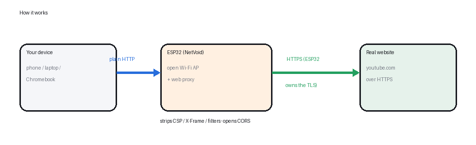
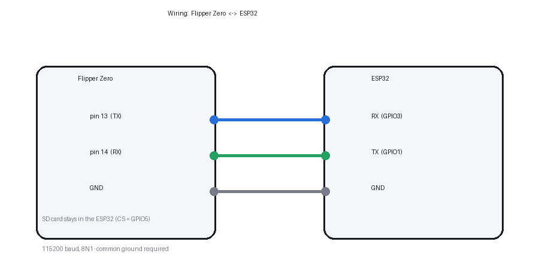
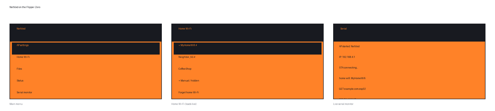

# NetVoid

**A pocket Wi-Fi access point, built on a bare ESP32, that lets any device browse the open
internet — including sites a network or device tries to block — by making the real HTTPS requests
itself and handing the pages back over plain HTTP.** It also serves games/apps off an SD card, and
ships with a Flipper Zero app ("NetVoid") that controls the whole thing from a menu.

> You join NetVoid's Wi-Fi like any hotspot, a page with an address bar opens, you type a site, and
> NetVoid fetches it for you — stripped of the rules (CSP, X-Frame-Options, etc.) that normally stop
> pages from being reframed or proxied.



---

## What it actually does

A normal device can't reach a blocked site because **its own network or software decides what it may
load**. NetVoid moves that decision off the device:

1. Your device joins NetVoid's **open Wi-Fi** and talks to it over ordinary HTTP.
2. NetVoid answers DNS for *every* hostname, so every address routes back to the little ESP32.
3. When you ask for `youtube.com`, **the ESP32 opens the HTTPS connection to YouTube itself** — it
   owns the TLS, so to YouTube it looks like a normal browser/device.
4. It streams the page back to you over HTTP, rewriting links on the fly and **removing the headers
   that block embedding/proxying** (CSP, X-Frame-Options, COOP/COEP/CORP, HSTS, etc.) and opening
   CORS.

Because the device only ever "sees" NetVoid's open Wi-Fi and plain HTTP, filtering that lives on the
*device* or on the *network it would otherwise use* is simply not in the path.

---

## Example use cases

These all share one trick: the restricted device is allowed to **join a Wi-Fi network and open its
sign-in / captive page** — and that page is a full web browser.

- **School Chromebooks (even with GoGuardian-style filtering).** The filter blocks sites on the
  school network. A Chromebook that can still connect to a nearby open Wi-Fi and open its captive
  "sign in to Wi-Fi" page can reach NetVoid's address bar and load YouTube through the ESP32 instead
  of through the school network.
- **Locked-down "kosher" / yeshivah phones.** Many filtered phones still allow joining Wi-Fi and
  displaying the network's sign-in page. That sign-in page is NetVoid's browser, so the phone gets a
  working address bar without changing anything on the phone itself.
- **Any kiosk / managed device with a Wi-Fi captive portal.** If the device pops up the "log in to
  this network" window when it joins Wi-Fi, that window is a browser pointed at NetVoid — type an
  address and go.

> **Use it on devices and networks you're allowed to.** This is a personal proxy (conceptually like a
> VPN); respect the acceptable-use policies of schools, employers, and device owners. The link
> between your device and NetVoid is **open and unencrypted**, so don't sign in to important accounts
> or enter payment info over it.

---

## What you need

- An **ESP32** board (plain ESP32 / WROOM, no PSRAM required).
  **Recommended:** the [**FlipMods Mini** by Sacred Labs](https://sacredlabstech.com/boards/mini/) —
  an ESP32‑WROOM‑32UE board that plugs straight onto the Flipper Zero's GPIO header **and** has an
  onboard **microSD slot** for your HTML/game files. It's been tested and verified to run NetVoid, so
  it gives you the ESP32, the SD storage, and the Flipper connection in a single board with no wiring.
  Its USB‑C port flashes the firmware directly (this overwrites the Marauder firmware it ships with).
  Any plain ESP32 with a microSD card wired to it also works.
- A **microSD card** for the SD server (**≤ 32 GB, formatted FAT32**; insert it before powering the
  board). Only needed to serve local games/apps and a default home page.
- A **Flipper Zero** (optional — only for the NetVoid control app; the firmware works standalone).
- A Windows PC with **Python** to build the firmware and do the **first** flash. After that you can
  re-flash the ESP32 **straight from the Flipper** — see [Flashing from the Flipper](#flashing-from-the-flipper) — no PC needed.

---

## Install — Part 1: flash the ESP32 firmware

1. Plug the **ESP32 into your PC** by USB (it shows up as a COM port, e.g. `COM8`).
2. Build and flash:

   ```powershell
   python build.py COM8
   ```

   This compiles the firmware and writes it to the board (~70 s, hash-verified). It does **not** use
   the Arduino IDE — `build.py` applies low-memory linker patches the IDE can't.

To restore the original firmware later: `esptool --port COM8 write-flash 0 backup/original-flash.bin`.

The firmware alone is fully usable: join its Wi-Fi and open `http://192.168.4.1/`. Read on for the
Flipper app, or see [DOCUMENTATION.md](DOCUMENTATION.md) for the serial console.

## Install — Part 2 (optional): the NetVoid Flipper app

If you're using the recommended [FlipMods Mini](https://sacredlabstech.com/boards/mini/), it mates
with the Flipper's GPIO header directly — just seat the board, nothing to wire. For a bare ESP32,
wire the Flipper's GPIO UART to the board (three wires):



Then build and install the app with [ufbt](https://pypi.org/project/ufbt/) (the Flipper on USB):

```powershell
cd flipper/esp_proxy
python -m ufbt launch
```

The app appears under **Apps → GPIO → NetVoid**.



From the app you can:

- **Start / stop** the access point and **rename** it or set a password.
- Pick your **home Wi-Fi** from a live scan (or enter a hidden SSID manually).
- Browse, edit, create, delete, and rename **files on the SD card**, and pick the default home page.
- Make the AP a **hidden** network.
- Watch a **live serial monitor** (captures in the background, keeps history when you leave it) and
  **log the whole session to the Flipper's SD card**.

> **Flashing the firmware from the Flipper** (over GPIO, no PC) isn't built into NetVoid yet — the
> existing **ESP Flasher** Flipper app already does this.

---

## Using it

1. On your device, join NetVoid's Wi-Fi (open by default). A sign-in / captive page opens by itself
   (or browse to `http://192.168.4.1/`, or `http://<ap-name>.local/`).
2. Tap **Browser** for the address bar (`http://proxy.esp32/`).
3. **First time only:** set your home Wi-Fi — in the NetVoid Flipper app (Home Wi-Fi), on the address
   bar's Wi-Fi panel, or by running `connect-wifi.ps1` with the ESP32 on USB (it reads your PC's saved
   Wi-Fi password and sends it over serial; the password is never shown or saved).
4. Type an address. `https://example.com/a` is served to you as `http://example.com.esp32/a`.

---

## Flashing from the Flipper

Once NetVoid is installed, you can re-flash the ESP32 from the Flipper with **no PC**:

1. **On the PC**, run `python build.py`. It writes a `firmware/` folder (bootloader, partitions,
   boot_app0, app, and `flash.txt`).
2. **Copy that `firmware/` folder to the Flipper's SD card** at `apps_data/esp_proxy/firmware/`
   (e.g. with qFlipper). You only re-copy it when the firmware changes.
3. Put the ESP32 in **download mode**: **hold BOOT, tap RESET, release BOOT.**
4. In NetVoid: **Flash ESP32 → Start flashing.** A progress screen shows each image as it writes.
5. It flashes over the same 115200 UART (~2–3 min). On success, **tap RESET** to run the new firmware.

> **Currently tested on the [FlipMods Mini](https://sacredlabstech.com/boards/mini/).** NetVoid talks
> to the ESP32's ROM bootloader over UART (no auto-reset wiring needed) — any board works as long as
> you can reach its BOOT/RESET buttons and its UART is on the Flipper's pins 13/14. If it can't
> connect, re-enter download mode (hold BOOT, tap RESET) and start again.

## Good to know

- Link to the ESP32 is **plain HTTP over open Wi-Fi** — don't sign in to sensitive accounts or pay.
- At most ~2 HTTPS connections at once (no PSRAM); **TLS 1.2 only**, no HTTP/2, service workers,
  WebCrypto subtle, camera, or DRM video.
- Bot checks (Cloudflare and similar) can still reject it; sites that hard-check their own hostname in
  JavaScript may break.
- Phones with strict **Private DNS / DNS-over-HTTPS** must turn it off while connected.
- A heavy page can brown out the board on weak USB power — use a solid charger/cable. The AP restarts
  itself after a crash.

**Full technical documentation** (architecture, the proxy pipeline, SD server, custom MAC, the entire
serial protocol, the Flipper app internals, troubleshooting): see **[DOCUMENTATION.md](DOCUMENTATION.md)**.

## License

[MIT](LICENSE).
